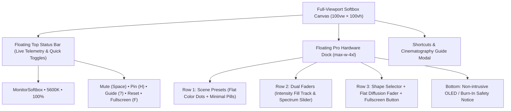

# MonitorSoftbox — Design System & Architecture Specification (`DESIGN.md`)

## 1. Overview & Core Philosophy

**MonitorSoftbox** turns any computer display into a calibrated key and fill light instrument for photography, videography, and streaming.

### The Problem with the Previous Design
- **Inverted Canvas**: Trapped the light emitter inside a tiny 16:9 preview box (`~15%` of the screen) while `85%` of the display was filled with dark gray settings cards.
- **Bulbous / Glossy Aero Artifacts**: Overuse of heavy specular gradients, crescent pseudo-elements, oversized shiny pills, and glowing buttons produced an unnatural, dated aesthetic.
- **Card Overload**: Bulky marketing cards filled with descriptions and badges.

### The Modern Pro Hardware Paradigm
1. **The Entire Viewport IS the Light**: From startup, `100vw × 100vh` is the active emitter surface. Every tweak to color, intensity, or aperture immediately illuminates the room in real time.
2. **Unified Canvas**: No separate "fullscreen mode component" vs "editor component". Entering fullscreen (`F`) simply maximizes the existing browser canvas seamlessly.
3. **Precision Matte Hardware Chrome**: All interface elements float over the light canvas inside refined, deep matte anodized surfaces (`#121214` at `88%` opacity with 24px backdrop blur) with razor-sharp 1px neutral borders.
4. **Intelligent Inactivity Auto-Hide**: Inactivity fades the HUD after 3 seconds for zero light interference; moving the cursor or pressing keyboard shortcuts wakes it instantly. A **Pin HUD (`H`)** toggle allows users to keep controls locked visible when adjusting lighting setups.

---

## 2. Visual Aesthetic: Precision Matte Dark Cinema Hardware

### 2.1 Surfaces & Materials
- **`.pro-dock` (Primary Floating Shell)**:
  - Background: `rgba(18, 18, 20, 0.88)`
  - Filter: `backdrop-filter: blur(24px)`
  - Border: `1px solid rgba(255, 255, 255, 0.08)`
  - Ambient Shadow: `0 24px 48px -12px rgba(0, 0, 0, 0.85), 0 0 0 1px rgba(0, 0, 0, 0.5)`
- **`.pro-well` (Recessed Control Well)**:
  - Background: `rgba(10, 10, 12, 0.75)`
  - Border: `1px solid rgba(255, 255, 255, 0.06)`
- **`.pro-pill` / `.pro-pill-active`**:
  - Inactive: `background: rgba(255, 255, 255, 0.04)`, `border: 1px solid rgba(255, 255, 255, 0.06)`
  - Active: `background: rgba(255, 255, 255, 0.12)`, `border: 1px solid rgba(255, 255, 255, 0.3)`
- **`.pro-dot` (Minimal Flat Color Indicator)**:
  - Minimal flat 10px circular color dot representing the preset's calibrated Kelvin or Gel color without shiny glossy reflections.
- **Sliders & Range Inputs**:
  - Slim, low-profile thumb (`18px`) with clean white finish and dark rim (`2px solid #18181b`), eliminating heavy bulbous gradients.

### 2.2 Color & Typography
- **Canvas Base**: Pure optical black `#000000` (used for aperture cutouts and blackout mode).
- **Interface Accents**: Monochrome white/zinc hierarchy with surgical color indicators (Planckian CCT locus spectrum and 360° HSI spectrum).
- **Typography**:
  - UI Labels: `Plus Jakarta Sans` with tight, natural letter-spacing.
  - Telemetry: `JetBrains Mono` with `tabular-nums` for smooth numeric readouts (`5600K`, `100%`) without layout shifting.

---

## 3. Implemented UI Layout

### 3.1 Floating Top Status Bar (`Header.tsx`)
- Compact hardware pill displaying live Kelvin/Hue and brightness telemetry.
- Quick action buttons: **Mute (`Space`)**, **HUD Pin (`H`)**, **Guide (`?`)**, **Reset**, and **Fullscreen (`F`)**.

### 3.2 Floating Hardware Control Dock (`SettingsPanel.tsx`)
1. **Scene Presets (`PresetSelector.tsx`)**:
   - Clean horizontal row of presets with flat color dots (`Daylight 5600K`, `Tungsten 3200K`, `Octa Catchlight`, `Webcam Ring Light`, `Key & Fill Bi-Color`, `Left Rim Strip`, `Golden Hour`, `Teal Gel`, `Neon Magenta Gel`).
2. **Dual Hardware Faders**:
   - **Intensity Fader**: Clean `h-8` track with crisp white level fill and quick buttons (`10%`, `25%`, `50%`, `75%`, `100%`).
   - **White Balance / Color Gel**: Spectrum slider with CCT Kelvin / HSI Gel toggles and quick Kelvin buttons (`2700K`, `3200K`, `4300K`, `5600K`, `6500K`).
3. **Modifier Strip**:
   - **Segmented Aperture Selector**: Minimal geometric icons (`Full`, `Octa`, `Box`, `Left Strip`, `Right Strip`, `Ring`, `Bi-Color`).
   - **Flat Diffusion Fader**: Integrated inline fader (`0%` to `100%`) without bulbous gradients.
   - **Geometry Drawer Toggle**: Configures custom width/height, circle diameter, ring hole, or Bi-Color dual split.
   - **High-Contrast Fullscreen Button**: Clean, bold button (`Fullscreen` / `Exit Fullscreen`).
4. **OLED Safety Notice**:
   - Embedded directly at the bottom of the dock in subtle, unobtrusive type:
     *"Notice: Strictly for standard LCD/IPS monitors. Not recommended for OLED/QD-OLED displays due to risk of burn-in."*

---

## 4. Keyboard Shortcuts Reference

| Shortcut | Description |
| :--- | :--- |
| `F` | Toggle Fullscreen |
| `Esc` | Exit Fullscreen |
| `Space` | Toggle Blackout / Standby Mute |
| `H` | Toggle Pin HUD (Lock visible vs. 3s Auto-hide) |
| `↑` / `↓` | Adjust Intensity ±5% |
| `←` / `→` | Adjust Color Temperature ±100K |
