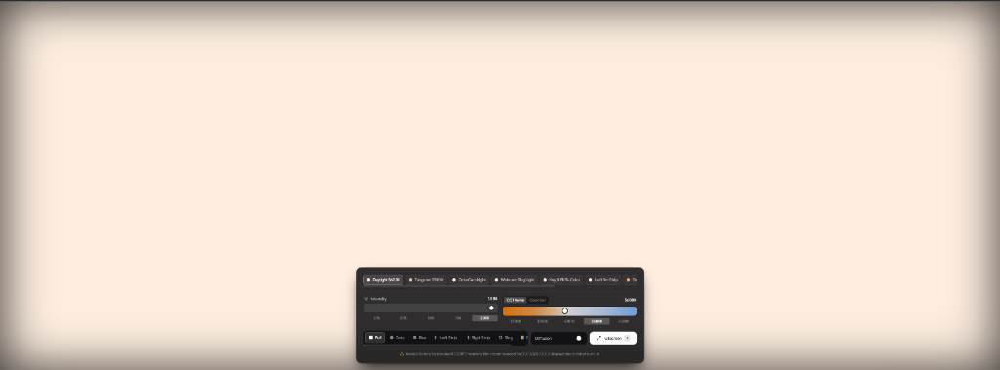

# MonitorSoftbox 💡🎬

> Transform your computer monitor into a professional, calibrated softbox key and fill light for photography, video calls, YouTube, and cinema production.



Live GitHub Pages path: `https://<username>.github.io/MonitorSoftbox/`

---

> [!CAUTION]
> ### ⚠️ OLED / QD-OLED Burn-in Disclaimer
> **DO NOT USE THIS APPLICATION ON OLED, QD-OLED, OR AMOLED DISPLAYS.**
> Projecting static high-brightness shapes, rings, split-tones, or high-contrast borders for sustained durations carries a severe risk of permanent subpixel burn-in (image retention) on organic emissive panels.
> **This tool is designed exclusively for standard LCD, LED-backlit, or IPS monitors and laptop displays.**

---

## ⚡ Features

- **White Balance / CCT (1,800K – 10,000K)**
  - Planckian locus simulation calibrated from candle flame (2000K) to deep blue daylight (8500K).
  - Quick cinematography presets: 2000K (Candle), 2700K (Warm), 3200K (Tungsten), 4300K (Halogen), 5600K (Studio Daylight standard), 6500K (Overcast/D65), 8500K (Blue Sky).
  - **Green / Magenta Tint (duv)** slider (-50 to +50) for matching camera sensors and ambient lights.
- **Color Gel / HSI Mode**
  - Full 360° Hue and Saturation control for vibrant mood lighting, streaming backgrounds, and edge rim lights.
- **Precision Brightness Control (1% – 100%)**
  - Smooth dimming with 10%, 25%, 50%, 75%, 100% quick steps.
- **Aperture & Shape Geometries**:
  - **Full Panel**: Entire monitor emits uniform light.
  - **Octa / Circular Catchlight**: Produces round, eye catchlights for portraiture and streaming.
  - **Rectangular Softbox**: Customizable width and height.
  - **Left / Right Rim Strip Light**: Side edge lights for chiseled jawlines and profile separation.
  - **Webcam Ring Light**: Halo shape leaving the center dark for your webcam or camera.
  - **Dual Key & Fill (Bi-Color Split)**: Split the monitor into Left (Key) and Right (Fill) with independent color temperatures and brightness levels!
- **Diffusion / Falloff Feathering (0% – 100%)**:
  - Optical gradient softness adjustment from razor-sharp edges to ultra-soft light falloff.
- **True Fullscreen Studio Experience**:
  - Fullscreen API support with auto-hiding HUD (fades after 2.5s of mouse inactivity for a distraction-free light source).
  - Screen WakeLock API integration so your display never dims or sleeps during filming.
  - **Instant Blackout / Standby** (`Space`) for A/B lighting comparison.
- **Studio Presets**:
  - One-click lighting recipes: *Daylight 5600K*, *Tungsten 3200K*, *Octa Catchlight*, *Webcam Ring Light*, *Key & Fill Bi-Color*, *Left Rim Strip*, *Golden Hour Glow*, and *Creative Gels*.

---

## ⌨️ Keyboard Shortcuts

| Shortcut | Action |
| --- | --- |
| `F` or `Esc` | Enter / Exit Fullscreen Mode |
| `Space` | Instant Blackout / Standby toggle |
| `↑` / `↓` | Increase / Decrease Brightness (±5%) |
| `←` / `→` | Adjust White Balance Kelvin (±100K) |
| `H` | Pin HUD in Fullscreen (prevents auto-hide) |

---

## 🛠️ Tech Stack

- **Vite 6**
- **React 19 + TypeScript**
- **Tailwind CSS**
- **Lucide React**
- **HTML5 Fullscreen & Screen Wake Lock APIs**

---

## 🚀 Getting Started

### Local Development

```bash
# Install dependencies
npm install

# Start local dev server
npm run dev
```

### Build for Production

```bash
npm run build
```

The production bundle will be created in the `dist/` directory with the `/MonitorSoftbox/` base path pre-configured.

---

## 📦 Deployment to GitHub Pages

### Option 1: Automated Deployment via GitHub Actions (Recommended)
This repository includes a pre-configured workflow at `.github/workflows/deploy.yml`.

1. Push your code to your GitHub repository on `main` or `master`.
2. In your GitHub repository:
   - Go to **Settings** > **Pages**.
   - Under **Build and deployment** > **Source**, select **GitHub Actions**.
3. Every push to `main` will build and deploy the app to `https://<username>.github.io/MonitorSoftbox/`.

### Option 2: CLI Deployment with `gh-pages`
```bash
npm run deploy
```
This builds the project and pushes the `dist/` directory to your `gh-pages` branch.
